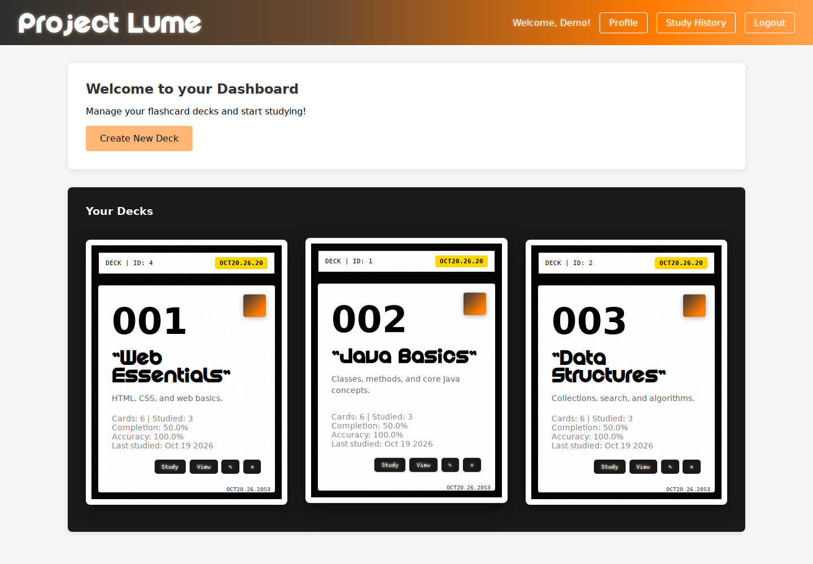
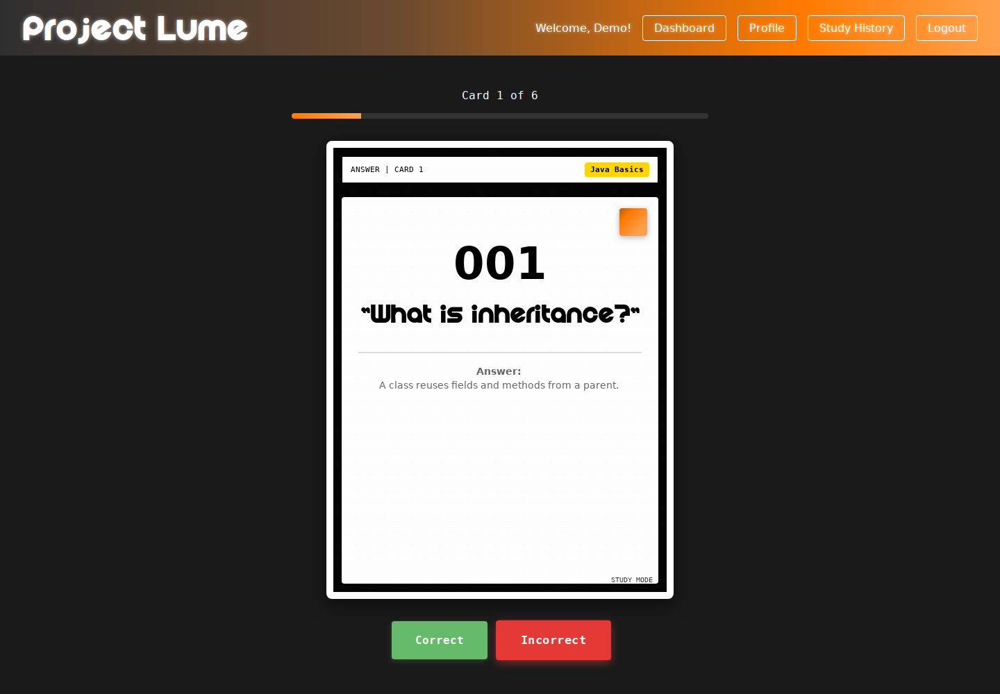
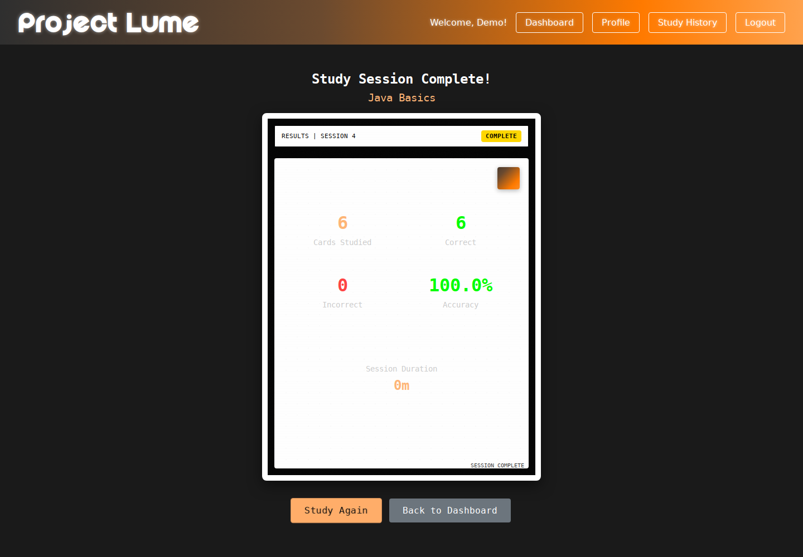

# Project Lume

A Java web application for flashcard study management, built with modern design patterns and optimized for deployment on Tomcat 9.

## Table of Contents

1. [Features](#features)
2. [Showcase](#showcase)
3. [Quick Start](#quick-start)
4. [Testing](#testing)

## Features

- User authentication and registration
- Deck and card management
- Study sessions with progress tracking
- Study history and statistics
- Responsive web interface

## Showcase

### Deck dashboard

Organize flashcard decks and track study progress.



### Interactive study

Flip flashcards to reveal answers and record your responses.



### Session results

Review your accuracy and performance after each study session.



*Screenshots show the running application with sample data.*

## Quick Start

### Prerequisites

- **JDK 21+**
- **Maven 3.9+**
- **MySQL 8.0+**
- **Apache Tomcat 9.0+**

### Development Build and Run

1. **Configure Database**
   
   Edit src/main/resources/database.properties or set environment variables

2. **Build Application**
   ```bash
   mvn clean package
   ```

3. **Run with Embedded Tomcat**
   ```bash
   mvn cargo:run
   ```
   The application will be available at: http://localhost:8081/project-lume-mvp/

The WAR file includes source code, excludes test files, and is optimized for Tomcat 9+. It will be created at: `target/project-lume-mvp.war`

### Testing

1. **Run Test Suite**
   ```bash
   mvn test
   ```
